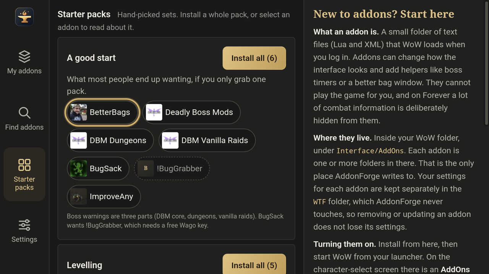

# AddonForge for Android

Install and update **World of Warcraft: Forever** addons on your Android handheld, with the controller in your hands. Made for the **AYN Thor**'s top screen in landscape.

This is an unofficial port of [AddonForge](https://github.com/Topher121/AddonForge) by Pocket Forge Studios. They don't make or support this version, so please send problems [here](https://github.com/grutamu/AddonForge-android/issues), not to them.

- **Made for the controller.** Every screen works with the D-pad and buttons. Touch works too.
- **Private.** No account, no ads, no analytics. The app talks only to the sites addons are published on (GitHub, Wago, WoWInterface, TukUI), plus GitHub to see if a new AddonForge is out.
- **Careful with your game.** It only ever changes `Interface/AddOns`. Your addon settings (in `WTF`) are never touched, and it refuses any download that contains a program.

## Install

1. On your Thor, open **[the latest release](https://github.com/grutamu/AddonForge-android/releases/latest)** and download the `AddonForge-android-….apk` file.
2. Open the downloaded file. The first time, Android asks you to allow installing apps from your browser (or file manager): allow it, go back and tap **Install**.
3. Open **AddonForge**. It explains why it needs **All files access** (your game folder was created by your WoW launcher, so Android asks), then sends you to the switch. Turn it on and come back.
4. AddonForge looks for your game. If you copied WoW: Forever somewhere unusual, press **Choose folder…** and pick the folder that holds `_classic_beta_`.

That's it: your addons show up under **My addons**, and AddonForge checks them for updates.

**New version of AddonForge?** A line at the top of the app says so. **Get it** opens the release page: download the new APK and install it over the old one. Your settings and addons stay.

**Automatic updates:** add `https://github.com/grutamu/AddonForge-android` to [Obtainium](https://github.com/ImranR98/Obtainium) and it will install new releases for you.

## Using it

| Screen | What you do there |
|---|---|
| **My addons** | Everything in your AddOns folder, with what needs updating. **Update all** updates everything at once. Select an addon to pin it to its current version, hide it, reinstall or remove it. |
| **Find addons** | The catalogue of addons that work on Forever. Search, sort by popularity, read about an addon and install it. You can also install from any GitHub link. |
| **Starter packs** | New to addons? Hand-picked sets (a good start, levelling, dungeons and raids, bags, chat…) you can install in one go, and a short guide to how addons work. |
| **Settings** | Game folder, your optional Wago key, controller layout, sharing your addon list, reporting a problem. |

### Controller

The default is the Nintendo layout printed on the Thor. If your controller says otherwise, switch to Xbox in **Settings → Controller** (it swaps A/B and X/Y); the same screen shows which button you just pressed.

| Button | Does |
|---|---|
| D-pad / left stick | Move around |
| **A** | Select, press |
| **B** | Back: closes a dialog, then the details, then goes to My addons, then leaves the app |
| **X** | The main action on the screen: Update all, Install, Install pack |
| **Y** | Search |
| **L / R** | Previous / next tab |
| **+** | Check for updates (on My addons) |

**Tip:** long-press the AddonForge icon on your home screen and choose **Update all**: it checks and updates everything without a single menu.

### Turning addons on in the game

Start WoW from your launcher. On the character-select screen there is an **AddOns** button in the corner: tick the ones you want. Already in game? Type `/reload` in chat (the launcher's keyboard has `/`).

## Questions

**It can't find my game.** Use **Choose folder…** (on the first-run screen, or in Settings) and pick the folder you copied the game into, or `_classic_beta_` inside it.

**An addon says "Needs Wago key".** Some authors only publish on Wago, whose API needs a free key from [addons.wago.io](https://addons.wago.io/account/apikeys). Paste it in Settings. It stays on your device and is only ever sent to Wago.

**An addon says "CurseForge only".** CurseForge doesn't let apps like this download from it. AddonForge shows you the addon's page instead.

**An addon says "not for Forever".** The author hasn't published a version for Forever yet. It may still load, or it may error in game.

**Android says "App not installed" when I update.** The new APK has to come from this project's releases page; a copy built or signed by someone else can't replace it. If you really need to, uninstall AddonForge first (your addons stay in the game folder; only AddonForge's own settings are lost).

**Does it work on other Android devices?** It's built and tested for the Thor's top screen in landscape. Other landscape Android handhelds with "All files access" should work, but nobody has tried yet.

**Can I move my addon list to another device?** Settings → **Share my list…** sends a small file (names and sources only, no settings). On the other device, **Import a list…** installs everything on it.

## Something wrong?

In the app: **Settings → Report a problem → Report on GitHub**. It opens a new issue with a diagnostics report filled in (version, game folder, addon list, last few log lines). Nothing is sent until you press submit, and you can read it first. Or [open an issue](https://github.com/grutamu/AddonForge-android/issues) yourself.

## Where addons come from

AddonForge reads your `Interface/AddOns` folder and each addon's `.toc` file to work out where it was published. On top of that there is a **catalogue**, a list of where each author publishes releases. Downloads always come straight from the author, never from a copy.

The catalogue and the download counts are maintained by the original AddonForge project. To get an addon listed or featured, use [their contributing guide](https://github.com/Topher121/AddonForge/blob/main/CONTRIBUTING.md).

| Source | Key needed? | Notes |
|---|---|---|
| GitHub releases | No | Preferred. |
| Wago Addons | Your own free key | Paste it in Settings. Only sent to addons.wago.io. |
| WoWInterface | No | |
| TukUI | No | ElvUI / Tukui. |
| CurseForge | Link only | Their API terms don't allow a key to ship inside an app. |

## How it's built

This port is maintained by [grutamu](https://github.com/grutamu) and developed on an AYN Thor. Like the original, much of the code is written with Claude (Anthropic's AI). It is open source under the MIT licence so you don't have to take any of this on trust: read it, build it yourself, or don't.

Developers: see [CONTRIBUTING.md](CONTRIBUTING.md) for building the APK and running the checks.

## Credits and licence

Based on [AddonForge](https://github.com/Topher121/AddonForge) by Pocket Forge Studios, MIT licensed. The original copyright notice is kept in [LICENSE](LICENSE).

AddonForge is an independent project. It is not affiliated with, endorsed by or connected to CurseForge, Overwolf, Blizzard Entertainment, Wago, WoWInterface or TukUI. World of Warcraft is a trademark of Blizzard Entertainment.
