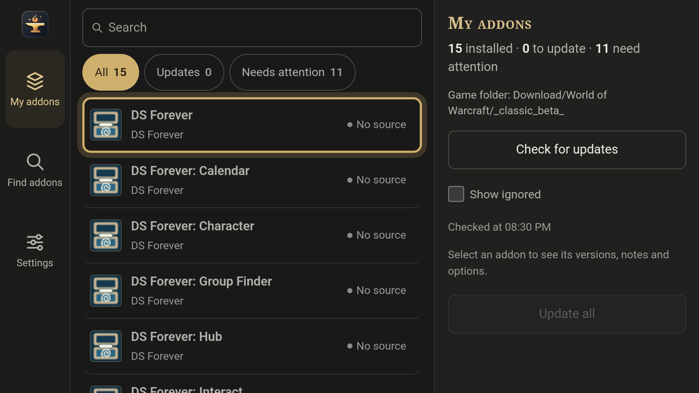
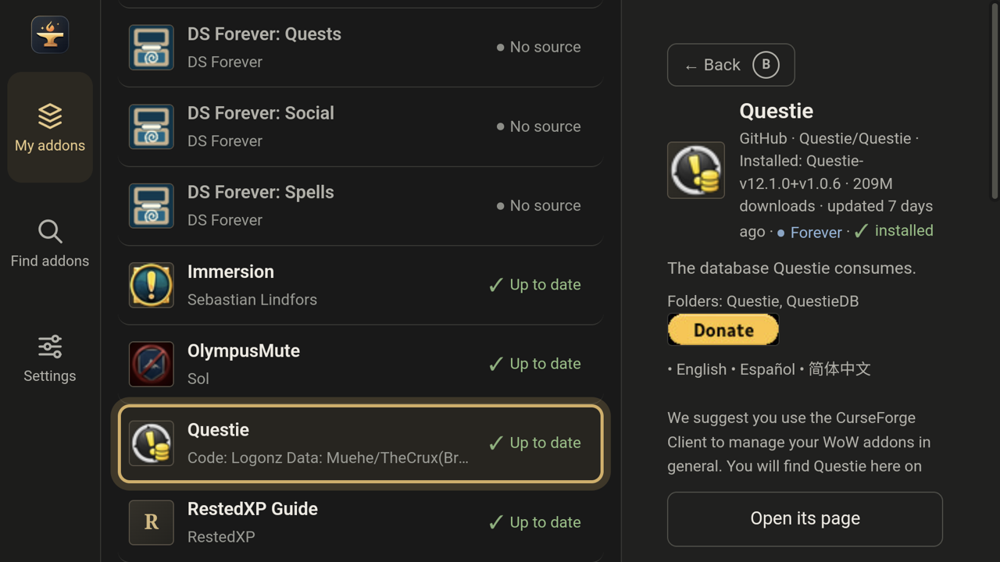
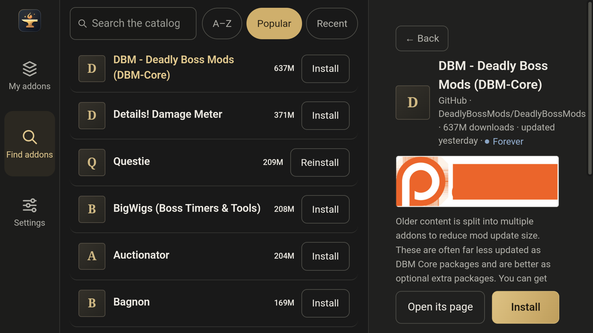
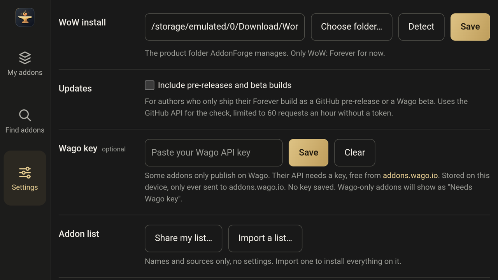

# AddonForge for Android

**Install and update World of Warcraft: Forever addons on your AYN Thor, using the controller.**

AddonForge finds your game folder and shows every addon you have. It tells you which ones have updates and updates them all with one button. You can also browse thousands of addons made for Forever and install them in a couple of presses.

- **Works with the controller.** Every screen works with the D-pad and buttons, and you can use touch too.
- **Safe for your game.** It only changes your `Interface/AddOns` folder. It never touches your addon settings (`WTF`), and it refuses any download that contains a program.
- **Private.** There are no accounts, ads or analytics. It talks only to the sites where addons are published.

> AddonForge for Android is an unofficial port of [AddonForge](https://github.com/Topher121/AddonForge) by Pocket Forge Studios. They don't make or support this version, so please [report problems here](https://github.com/grutamu/AddonForge-android/issues), not to them.

---

## Getting started

### 1. Install the app

1. On your Thor, open the **[latest release](https://github.com/grutamu/AddonForge-android/releases/latest)** and download the `.apk` file.
2. Open the downloaded file and tap **Install**. If Android asks, allow your browser or file manager to install apps, then go back and tap **Install** again.

> **Tip: get updates automatically.** Add `https://github.com/grutamu/AddonForge-android` to [Obtainium](https://github.com/ImranR98/Obtainium) and it will keep AddonForge up to date for you.

### 2. Allow file access

The first time you open AddonForge, it asks for **All files access**. Your game folder was created by your WoW launcher, not by AddonForge, so Android needs your permission before AddonForge can change it. Press **Allow file access**, turn the switch on, then come back.

AddonForge only ever writes inside `Interface/AddOns`.

### 3. Let it find your game

AddonForge looks for WoW: Forever on its own and usually finds it straight away, for example in `Download/World of Warcraft`. If it can't, press **Choose folder…** and pick the folder you copied the game into (the one that holds `_forever_`).

That's all. Your addons appear under **My addons**.

---

## Using AddonForge

The app has three tabs down the left side. Press **L** or **R** to switch between them.

### My addons

Shows everything in your AddOns folder, with the status of each addon.

| Status | What it means |
|---|---|
| ✓ **Up to date** | You have the latest version. |
| **Update available** | A newer version is out. |
| **No source** | AddonForge doesn't know where this addon is published, so it can't update it. The addon still works in game. |
| **Needs Wago key** | The author only publishes on Wago. See [Wago key](#wago-key-optional) below. |
| **Error** | The last check or update failed. Select the addon to see why. |

- **Update all** updates every addon that has an update, one at a time. The side panel shows how far it has got, then what was updated and anything that failed.
- **Check for updates** checks again. On this tab you can also press **Start**.
- The **All / Updates / Needs attention** filters narrow the list. "Needs attention" collects anything with a problem, such as no source, a missing dependency or no Forever version.

Select an addon to see its versions, a short description and what you can do with it. When an update is waiting, **What's new** shows the author's release notes, so you can decide before you update (CurseForge doesn't share them, so its addons don't have this).

| Option | What it does |
|---|---|
| **Update** / **Reinstall** | Download the latest release, or the current one again. |
| **Go back to …** | Shown after an update. Puts back the version you had before and pins it, in case the update broke something. The newer version is kept too, so you can switch back. |
| **Pin version** | Keep it at this version. **Update all** skips it until you press **Allow updates**. |
| **Ignore** | Hide it and stop checking it for updates. Tick **Show ignored** to see it again. |
| **Remove** | Delete its folders. Its saved settings in `WTF` stay, so they come back if you reinstall it. |

If an addon needs another addon that you don't have, the details say so, and you can usually install the missing one from there.

### Find addons

The catalogue lists addons that are tagged for WoW: Forever. Search it, or sort by **A–Z**, **Popular** or **Recent**. Select an addon to read about it, then press **Install** (or **X**).

Is the addon you want missing from the catalogue? If it's on GitHub, type its `owner/repo` or paste its link under **Install from GitHub**.

### Settings

- **WoW install:** the game folder AddonForge manages. **Detect** searches for it again, and **Choose folder…** lets you pick it yourself.
- **Include pre-releases and beta builds:** turn this on only if an addon you use releases its Forever version as a beta.
- **Wago key** (optional): see below.
- **Addon list:** **Share my list…** saves a small file with your addons' names and where they come from. It contains no settings. Open it on another device with **Import a list…** to install all of them.
- **Report a problem:** see [Something wrong?](#something-wrong)

#### Wago key (optional)

Some addon authors publish only on Wago, and Wago requires a free key to download. Get one at [addons.wago.io](https://addons.wago.io/account/apikeys) and paste it here. The key stays on your Thor and is only ever sent to Wago. You don't need it for anything else.

---

## Controller

| Button | What it does |
|---|---|
| D-pad / left stick | Move around |
| **A** | Select / press |
| **B** | Go back: closes a dialog, then the details, then returns to My addons, then leaves the app |
| **X** | The main action on the screen: **Update all** on My addons, **Install** on an addon's details |
| **Y** | Search |
| **L / R** | Previous / next tab |
| **Start** | Check for updates (on My addons) |

> **Shortcut:** long-press the AddonForge icon on your home screen and choose **Update all**. It checks for updates and installs them in one go.

---

## Turning addons on in the game

Installing an addon puts it in your game folder. To use it:

1. Start WoW: Forever.
2. On the character-select screen, press the **AddOns** button and tick the addons you want.
3. Already in the game? Type `/reload` in chat to load newly installed addons.

---

## Updating AddonForge itself

When a new version of AddonForge is out, a line appears at the top of the app. Press **Get it**, then download and install the new `.apk` over the old one. Your addons and settings stay. If you use Obtainium, it updates the app for you.

---

## Questions

**It can't find my game.**
Go to **Settings → WoW install → Choose folder…** and pick the folder you copied the game into, or `_forever_` inside it.

**An addon says "No source".**
AddonForge couldn't work out where that addon is published, often because you installed it by hand from somewhere it doesn't know about. The addon still works, but AddonForge can't update it. If it's on GitHub, you can reinstall it with **Install from GitHub** and AddonForge will keep it updated from then on.

**An addon warns "No Forever build found".**
The author hasn't released a version made for Forever yet. It may still work, or it may show errors in game.

**A CurseForge addon won't download.**
For addons that are only on CurseForge, AddonForge reads the file list from cfwidget.com. If that site is down, the addon shows an error. Press **Open its page** to download it by hand, or try again later.

**Android says "App not installed" when I update AddonForge.**
Only APKs from this project's [releases page](https://github.com/grutamu/AddonForge-android/releases) can install over your copy. If you really have to, uninstall AddonForge first. Your addons stay in the game folder; you only lose AddonForge's own settings.

**Does it work on other Android devices?**
It's made and tested for the AYN Thor, on either screen: on the smaller bottom screen the list takes the full width and an addon's details open in its place. Other landscape Android handhelds may work, but nobody has tested them.

**Where does "Go back" keep the old version?**
In `Interface/AddOns/.addonforge-backup`, one earlier version per addon. WoW doesn't load anything from there. Removing an addon deletes its copy too.

**Does removing an addon delete my settings for it?**
No. Settings are saved in the game's `WTF` folder, which AddonForge never touches.

---

## Something wrong?

In the app, go to **Settings → Report a problem → Report on GitHub**. It builds a report with your app version, game folder, addon list and recent log lines, and opens a new issue for you (you need a GitHub account). Nothing is sent until you press submit, and you can read the report first.

You can also [open an issue](https://github.com/grutamu/AddonForge-android/issues) yourself.

---

## Privacy

AddonForge has no account, ads or analytics. It connects only to:

- the sites addons come from: **GitHub, Wago, WoWInterface, TukUI and CurseForge** (plus **cfwidget.com** for CurseForge file lists),
- **GitHub**, once at launch, to check whether a new AddonForge is out.

Downloads always come straight from where the author publishes the addon, never from a copy.

---

## Credits

- Based on [AddonForge](https://github.com/Topher121/AddonForge) by Pocket Forge Studios. Released under the MIT licence; see [LICENSE](LICENSE).
- The addon catalogue comes from [instawow](https://github.com/layday/instawow)'s public list ([layday/instawow-data](https://github.com/layday/instawow-data)), refreshed daily. AddonForge isn't affiliated with instawow.

AddonForge is an independent project, not affiliated with or endorsed by Blizzard Entertainment, CurseForge, Overwolf, Wago, WoWInterface or TukUI. World of Warcraft is a trademark of Blizzard Entertainment.

*Building it yourself? See [docs/testing.md](docs/testing.md).*
